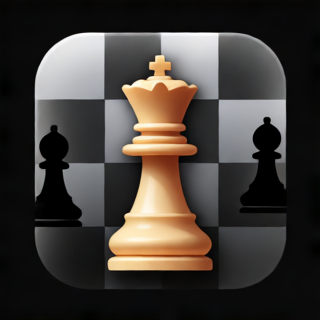
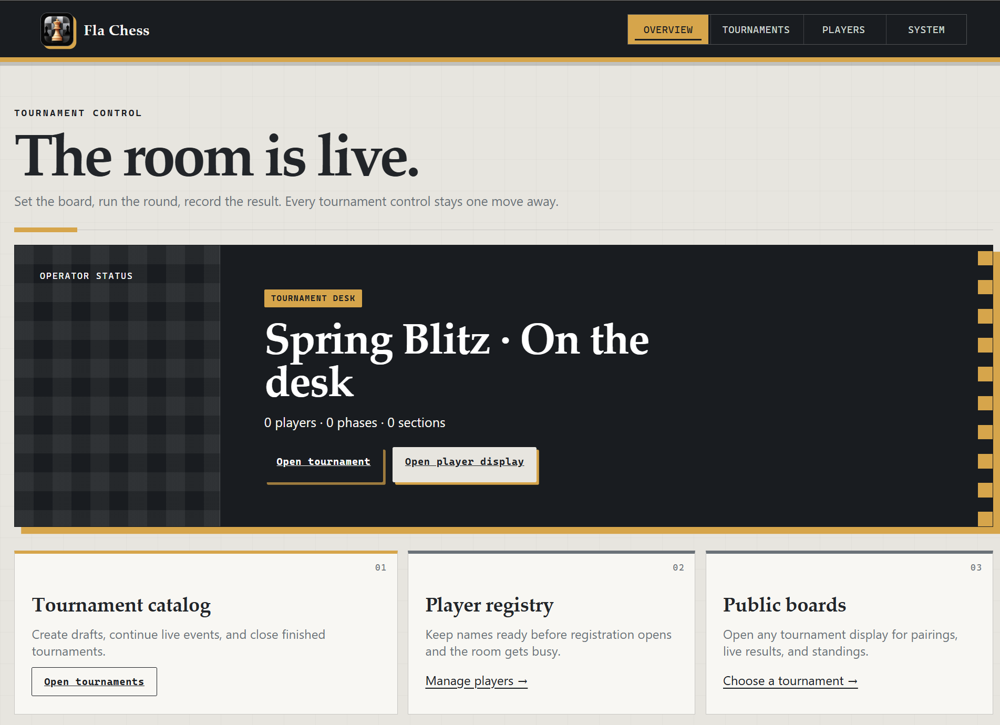
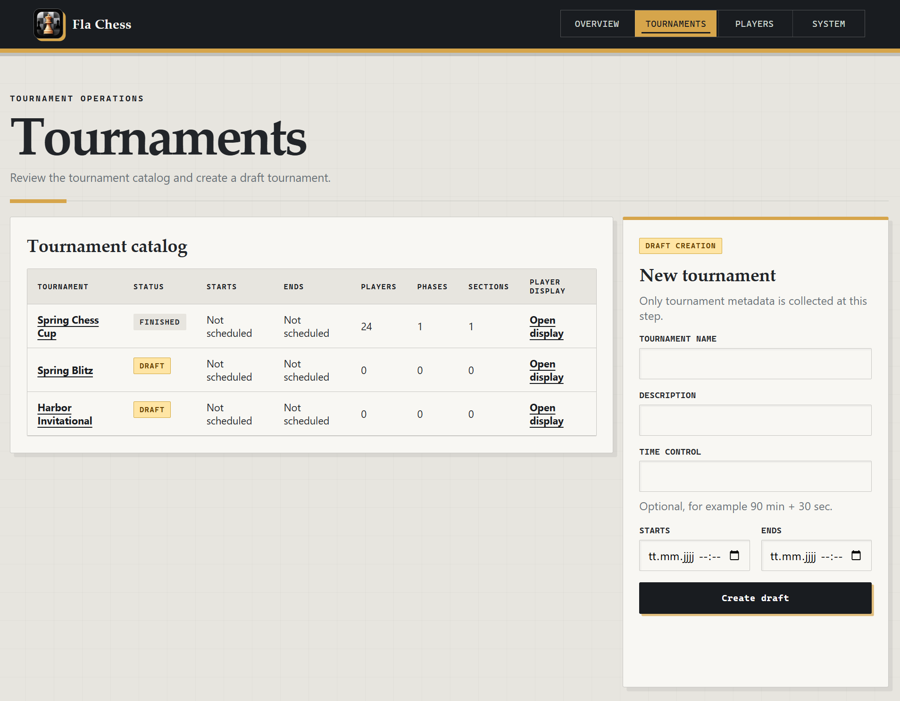
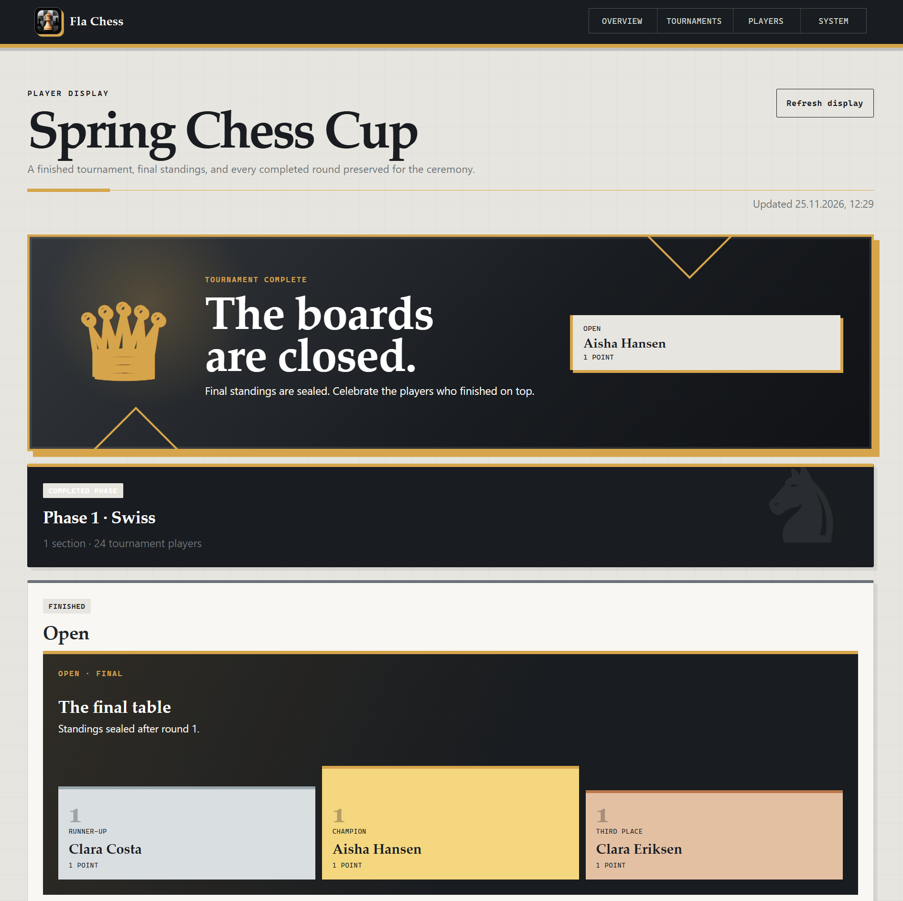

<div align="center">
  

  # Fla Chess

  **Run the tournament. Keep your eyes on the board.**

  A self-hosted tournament desk for blitz chess: registrations, pairings,
  live standings, and the final ceremony in one focused operator workspace.

  [See the walkthrough](#from-first-move-to-final-table) ·
  [Get started](docs/GETTING_STARTED.md) ·
  [Explore the data model](docs/DATA.md)
</div>

---

## The tournament room, without the spreadsheet

Fla Chess gives a single operator the complete path from an empty draft to a
finished tournament. It is deliberately local, direct, and calm enough to use
while the clock is running.

<p align="center">
  
</p>

### One desk. Every round.

<table>
  <tr>
    <td width="33%" valign="top">
      <strong>Set the field</strong><br>
      Build reusable player records, create tournaments, assign sections, seed
      players, and define the route through the event.
    </td>
    <td width="33%" valign="top">
      <strong>Run the games</strong><br>
      Create Swiss, round-robin, or knockout pairings, review the plan, record
      results, handle byes, and keep the next round moving.
    </td>
    <td width="33%" valign="top">
      <strong>Tell the story</strong><br>
      Show live pairings and standings on a public board, revisit earlier
      rounds, and finish with preserved champions and podiums.
    </td>
  </tr>
</table>

## From first move to final table

### 01 — Open the catalog

Create a draft, see what is active, and return to completed events without
hiding structure behind a wall of forms.

<p align="center">
  
</p>

### 02 — Shape the tournament

Draft workspaces connect player registration, phases, sections, seeds,
planned rounds, and ordered tie-break rules. Fla Chess keeps activation
blocked until the tournament is ready.

### 03 — Play the round

The operation view puts the active round and incomplete results first.
Pairing previews stay separate from commitment, so an operator can inspect
named pairings, colors, byes, warnings, and format policy before writing a new
round.

### 04 — Close with a ceremony

Finished sections retain their final standings. The read-only player display
turns those preserved results into champions, podiums, and browsable history.

<p align="center">
  
</p>

## Designed for a live room

- **Operator-first navigation** that keeps the active round close.
- **Transactional pairing generation** with preview, revalidation, and
  conflict recovery.
- **Swiss, round-robin, and knockout support** through the same operation flow.
- **Authoritative standings and tie-breaks** recomputed after result changes.
- **A read-only tournament display** for a shared screen in the playing room.
- **No frontend build step**: browser-native JavaScript and CSS served by FastAPI.
- **Local persistence** in PostgreSQL, with migrations managed by Alembic.

## Start the board

The shortest local path is Docker Compose:

```powershell
Copy-Item .env.example .env
docker compose up --build
```

Then open [http://127.0.0.1:8000](http://127.0.0.1:8000).

For host-based development, database tools, migrations, API behavior, and
operator workflows, follow the
**[getting-started guide](docs/GETTING_STARTED.md)**.

## Choose your next document

| I want to… | Start here |
| --- | --- |
| Install and run Fla Chess | [Getting started](docs/GETTING_STARTED.md) |
| Understand the project shape | [Design](docs/DESIGN.md) |
| Work with tournaments and persisted data | [Data model](docs/DATA.md) |
| Trace pairing automation | [Automation](docs/AUTOMATION.md) |
| Understand ranking rules | [Tie-breaks](docs/TIE_BREAKS.md) |
| Reuse server-side CRUD patterns | [CRUD helpers](docs/CRUD_HELPERS.md) |
| Follow repository task history | [Workflow](docs/workflow/README.md) |

## Built with

**FastAPI** · **PostgreSQL** · **SQLAlchemy** · **Alembic** ·
**browser-native JavaScript**

> Fla Chess currently assumes one operator on a physically protected system.
> The SQLAdmin and application routes are not protected by authentication.
> Review deployment boundaries before exposing the service beyond a trusted
> local environment.
